# GL HMIS — Database Schema & Data Flow

> ASP.NET WebForms + LINQ-to-SQL HMIS. DB: `H_P_National_Hospital` on `NOUMANPC`.
> **317 tables.** Only **25 real DB FKs.** Every other link = logical, enforced in code.
> Rule for newcomers: **"FK col name" reveals parent. No constraint = no protection."**

---

## 0. The Universal Pattern — read this first

```
[Master]            [Linker]            [Child]            [Detail]
pat_id       →  reg_patid        →  Out_Patient_ID   →  Bill_Details_ID
Reg_patient      Out_Patient /         (encounter)        (line items)
                 Emergency /
                 In_Patient
```

**Tenant scope** (every row has these — set by `AppConfig.*`):
- `Company_ID` → `sys_Companys.Company_ID`
- `Book_ID` → `GL_SetOfBook.Book_ID`

**Audit cols** (almost every table):
- `Created_By` / `Updated_By` / `Approved_By` → `aspnet_Users.UserId` (Guid)
- `Created_Time` / `Updated_Time`

---

## 1. System — Auth & Tenancy

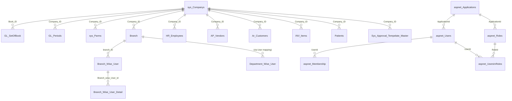

**Tenant root:** `sys_Companys` → every business row carries `Company_ID`.
**Auth:** `aspnet_*` = stock ASP.NET Membership. `aspnet_RolesInMenus` = role→menu map.
**Menu/route gating:** `Menus`, `Role_Page`, `aspnet_RolesInMenus`.

---

## 2. The Patient Universe — THE core flow

### 2.1 Patient root + every link

```mermaid
erDiagram
    Reg_patient ||--o{ Patients : "pat_id → Reg_PatId"
    Reg_patient ||--o{ Out_Patient : "pat_id → Reg_PatId"
    Reg_patient ||--o{ In_Patient : "pat_id → Patient_ID + Reg_PatId"
    Reg_patient ||--o{ Emergency : "pat_id → Reg_PatId"
    Reg_patient ||--o{ Emergency_Case : "pat_id → Reg_PatId"
    Reg_patient ||--o{ Emergency_Patient : "pat_id → Patient_ID + Reg_PatId"
    Reg_patient ||--o{ Appointment_Form : "pat_id → Reg_id"
    Reg_patient ||--o{ Birth_Certificate : "pat_id → Patient_ID"
    Reg_patient ||--o{ OPD_Refund : "pat_id → Reg_PatId"
    Reg_patient ||--o{ Reg_Patient_Logs : "pat_id → Pat_Id"
    Reg_patient ||--o{ Lab_Resultrpt : "pat_id → Patient_ID"
    Reg_patient ||--o{ Dialysis_Case : "pat_id → Patient_ID"
    Reg_patient ||--o{ Operation_Booking : "pat_id → Patient_ID"
    Reg_patient ||--o{ Sample_Master : "pat_id → Patient_ID"

    Patients ||--o{ Out_Patient : "Patient_ID"
    Patients ||--o{ In_Patient : "Patient_ID"
    Patients ||--o{ Emergency_Patient : "Patient_ID"
    Patients ||--o{ Emergency_Case : "Patient_ID"
    Patients ||--o{ Consultation_Booking : "Patient_ID"
    Patients ||--o{ Patient_Appointment : "Patient_ID"
    Patients ||--o{ Discharge : "Patient_ID"
    Patients ||--o{ Ar_Billings : "Patient_ID"
    Patients ||--o{ Ar_PaymentForm : "Patient_ID"
    Patients ||--o{ Sample_Master : "Patient_ID"
    Patients ||--o{ Birth_Certificate : "Patient_ID"
    Patients ||--o{ Dialysis_Case : "Patient_ID"
    Patients ||--o{ Operation_Booking : "Patient_ID"

    Out_Patient ||--o{ Out_Patient_Eye_Info : "Out_Patient_ID + Patient_ID"
    Out_Patient ||--o{ Out_Patient_Slit_Lamp_Exam : "Out_Patient_ID + Patient_ID"
    Out_Patient ||--o{ OutPatientComplaints : "(via EyeDetails or direct)"
    Out_Patient ||--o{ OutPatientPrimaryDiagnosis : ""
    Out_Patient ||--o{ OutPatientFinalDiagnosis : ""
    Out_Patient ||--o{ OutPatients_Protos : ""
    Out_Patient ||--o{ EyeDetails : "via TransactionID"
    Out_Patient ||--o{ Ortho : ""
    Out_Patient ||--o{ Ar_Billings : "Out_Patient_ID = Ar_Billings.Opd_Id"

    In_Patient ||--o{ In_Patient_Srvc_Dtl : "In_Patient_ID"
    In_Patient ||--o{ In_Patient_Medicines : "Patient_ID + In_Patient_ID"
    In_Patient ||--o{ InPatientServices : ""
    In_Patient ||--o{ InPatient_Doctor_Note : ""
    In_Patient ||--o{ InPatient_Instruction : ""
    In_Patient ||--o{ InPatient_Monitoring : ""
    In_Patient ||--o{ InPatient_Monitoring_Detail : ""
    In_Patient ||--o{ InPatient_Mon_InTake : ""
    In_Patient ||--o{ InPatient_Mon_Output : ""
    In_Patient ||--o{ InPatient_Mon_Progress_Note : ""
    In_Patient ||--o{ Room_Allocation : "In_Patient_ID + Patient_ID"
    In_Patient ||--o{ Room_Allocatrion_History : ""
    In_Patient ||--o{ Ward_Allocation : ""
    In_Patient ||--o{ Discharge : "Patient_ID"
    In_Patient ||--o{ Ar_Billings : "In_Patient_ID"
    In_Patient ||--o{ Ar_PaymentForm : "In_Patient_ID"

    Emergency ||--o{ Emergency_Case : "Emer_id → Emergency_Case.emer_id (logical)"
    Emergency ||--o{ Emergency_Patient : "(Admission path)"
    Emergency_Case ||--o{ Emergency_Patient : ""
    Emergency_Case ||--o{ Emergency_Case_Srvc_Dtl : "Emergency_Case_ID"
    Emergency_Case ||--o{ Emergency_Doctor_Note : "PatientId + EmergencyId"
    Emergency_Patient ||--o{ Emergency_refund : "Emer_id + pat_id"
    Emergency_Patient ||--o{ In_Patient : "(admit → IPD)"

    Discharge ||--o{ Discharge_Details : "Discharge_ID"
    OPD_Refund ||--o{ Refund : "(chain to AR refund)"

    Patients ||--o{ Next_To_Kin : "via Guardian_Id"
    Patients ||--o{ Previous_Dpt : "(visit history)"
```

### 2.2 Patient journey data flow

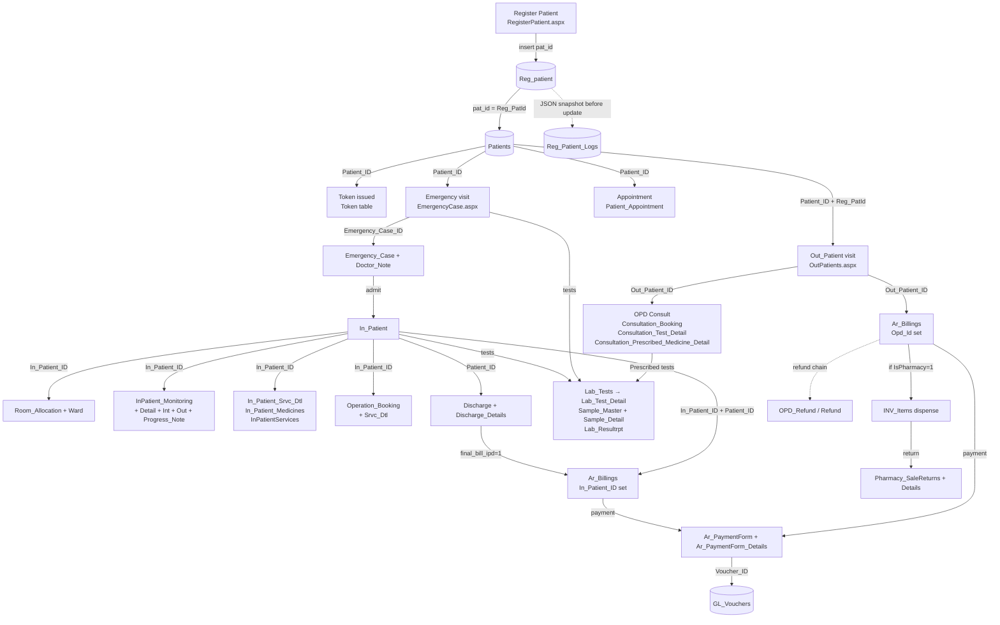

**Key paths a newcomer must memorise:**

| Path | Code | Tables touched |
|------|------|----------------|
| Register | `Modules/PatientManagement/RegisterPatient.aspx.cs` | `Reg_patient` → `Patients` |
| OPD | `Modules/PatientManagement/OutPatients.aspx.cs` | `Reg_patient` → `Out_Patient` → `Ar_Billings` |
| Emergency | `Modules/PatientManagement/EmergencyCase.aspx.cs` | `Reg_patient` → `Emergency` → `Emergency_Case` → `Emergency_Patient` |
| Admit | `Modules/PatientManagement/EmergencyAdmission.aspx.cs` | `Emergency_Patient` → `In_Patient` + `Room_Allocation` |
| IPD | `Modules/PatientManagement/InPatientsAdmission.aspx.cs` | `In_Patient` + services/notes/monitoring |
| Discharge | `Modules/PatientManagement/InPatientsDischarge.aspx.cs` | `Discharge` + `Ar_Billings` (`final_bill_ipd=1`) |
| Bill | `Modules/Billing/*.aspx.cs` | `Ar_Billings` + `Ar_Billing_Details` |

---

## 3. Billing & Payments

```mermaid
erDiagram
    Ar_Billings ||--o{ Ar_Billing_Details : "Bill_ID"
    Ar_Billings ||--o{ Ar_Billing_Logs : "Bill_Id"
    Ar_Billings ||--o{ Pharmacy_SaleReturns : "Bill_ID"
    Ar_Billing_Details ||--o{ Pharmacy_SaleReturn_Details : "Bill_Details_ID"
    Ar_Billings ||--|| Patients : "Patient_ID"
    Ar_Billings ||--o| Out_Patient : "Opd_Id"
    Ar_Billings ||--o| In_Patient : "In_Patient_ID"
    Ar_Billings ||--o| Emergency : "(via Reg_PatId)"

    Ar_Billings ||--o{ Ar_PaymentForm : "(Patient_ID many-to-1)"
    Ar_PaymentForm ||--o{ Ar_PaymentForm_Details : "PaymentForm_ID"

    Ar_Billings ||--|| HR_Employees : "Doctor_ID"
    Ar_Billings ||--o{ AR_Billing_Detail_Doctor_Share : "(share split)"

    Ar_Billings ||--o| Panel : "Panel_Id"
    Ar_Billings ||--o| Appointment_Form : "Appointment_id"

    AR_Advances ||--|| Patients : "Patient_ID"
    AR_Advances ||--o| In_Patient : "In_Patient_ID"

    Ar_Customers ||--o{ AR_Invoice : "Customer_ID"
    AR_Invoice ||--o{ AR_Invoice_Items : "Invoice_ID"
    Ar_Customers ||--o{ AR_Quotations : "Customer_ID"
    AR_Quotations ||--o{ AR_Quotation_Items : "Quotation_ID"
    Ar_Customers ||--o{ Ar_Sales : "Customer_ID"

    OPD_Refund ||--|| Reg_patient : "Reg_PatId"
    Emergency_refund ||--|| Emergency : "Emer_id"
    Refund ||--o{ Refund_Detail_Services : ""
    Refund ||--o{ Refund_Detail_Doctor_Share : ""
    Refund_Detail_Services ||--o| Ar_Billing_Details : "via ParentTrans"
```

**Decoding `Ar_Billings`:**
- `IsPharmacy=1` → pharmacy sale; `pharmacy_Department` set
- `Opd_Id` set → OPD encounter; `In_Patient_ID` set → IPD encounter
- `PatientDischargeBilling=1` and `final_bill_ipd=1` → final IPD discharge bill
- `IsRefund=1` → marked refunded
- `Doctor_Share` / `Hospital_Share` / `CGS` per detail line → split revenue
- `Voucher_ID` → `GL_Vouchers` link (post to GL)

---

## 4. Lab / Radiology / Endoscopy

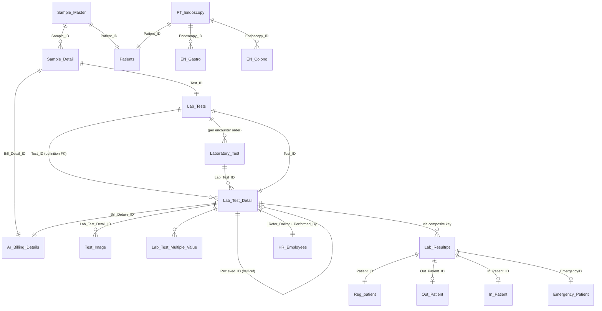

**Radiology = same tables**, filtered on `Ar_Billing_Details.Test_Main_Department IN ('002','003','004')` — see `Lab/RadiologyTestResult.aspx.cs:1421`.

**Lab chain:** `Bill (Ar_Billings/Ar_Billing_Details) → Lab_Tests (definition) → Sample_Master → Sample_Detail → Laboratory_Test → Lab_Test_Detail → Test_Image/Test_Values → Lab_Resultrpt (final report link)`.

---

## 5. Dialysis

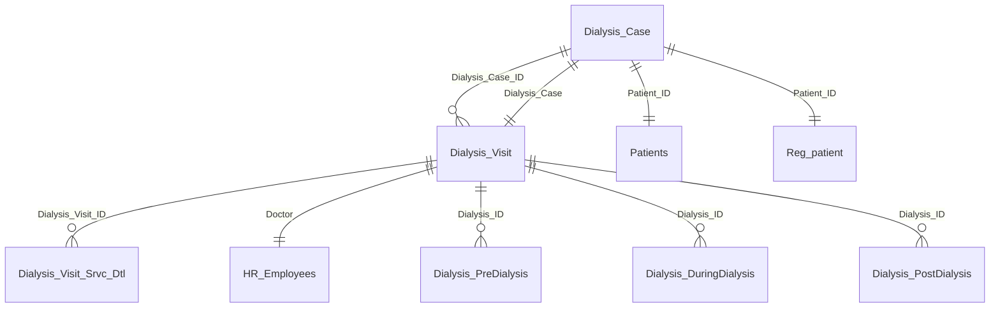

---

## 6. Blood Bank

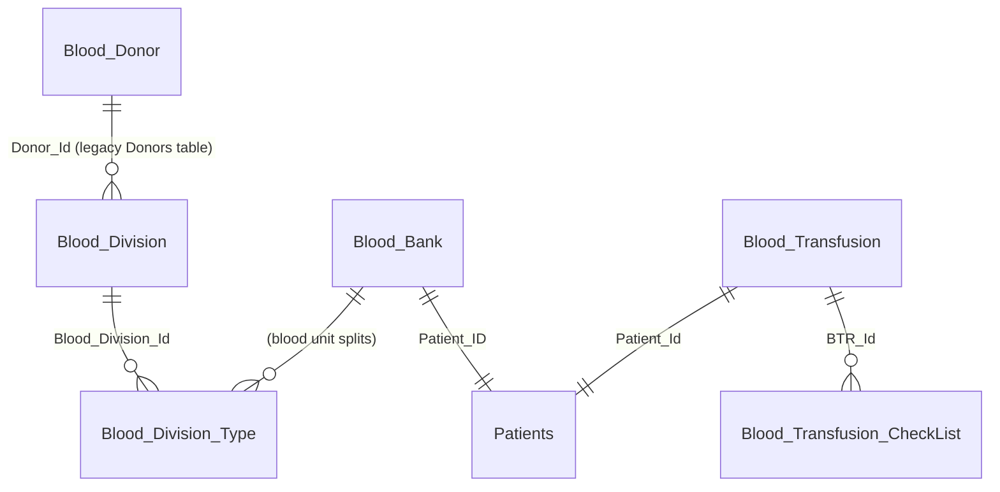

**Caveat:** `Blood_Division.Donor_Id` points to legacy `Donors` table (not `Donor`) — confirmed in raw SQL grep.

---

## 7. OT / Operation Theatre

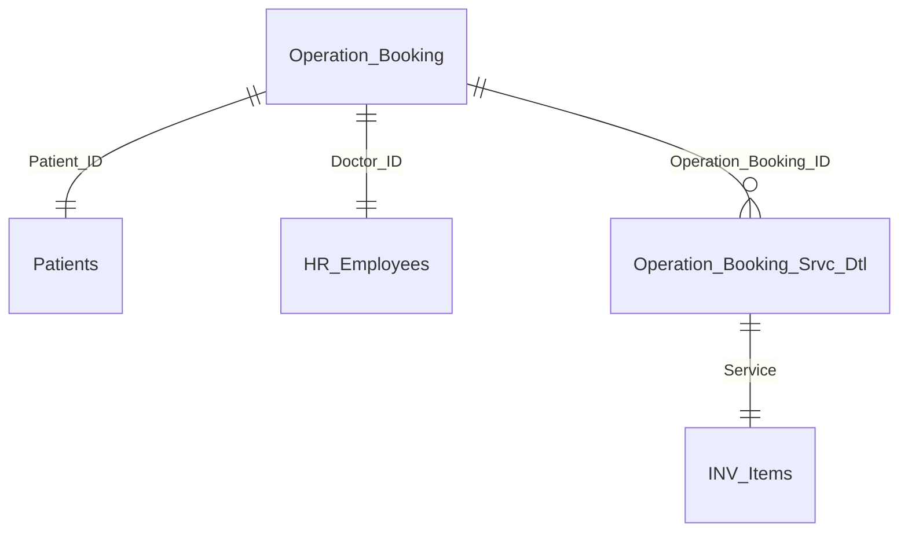

---

## 8. Inventory & Purchase (AP)

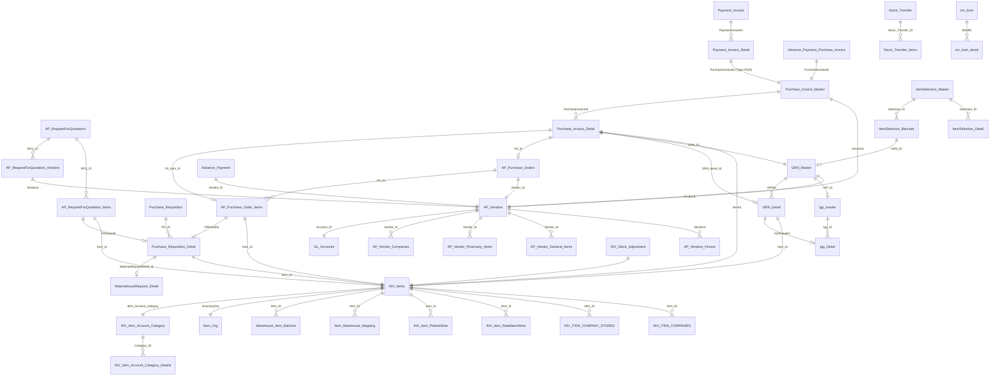

**AP/Inventory trace a newcomer must know:**

```
MaterialIssueRequest (GIR)
        ↓ MaterialRequest_Id
Purchase_Requisition (PR)
        ↓ PR_Detail_ID
Purchase_Requisition_Detail
        ↓ PRDetailId
AP_RequestForQuotation_Items ─→ RFQ ─→ vendors bid
        ↓ PRDetailId
AP_Purchase_Order_Items (PO)
        ↓ PO + items
GRN (goods receipt against PO)
        ↓ GRN_ID
Purchase_Invoice_Detail
        ↓ PurchaseInvoiceId
Payment_Invoice_Detail (settles PI)
        ↓ Voucher_ID
GL_Vouchers (posted to GL)
```

**Approval trail:** every step writes `Sys_Approval_Logs` row keyed by `Form_ID` constant (PR=1, PO=3, PI=10 …).

---

## 9. General Ledger (GL)

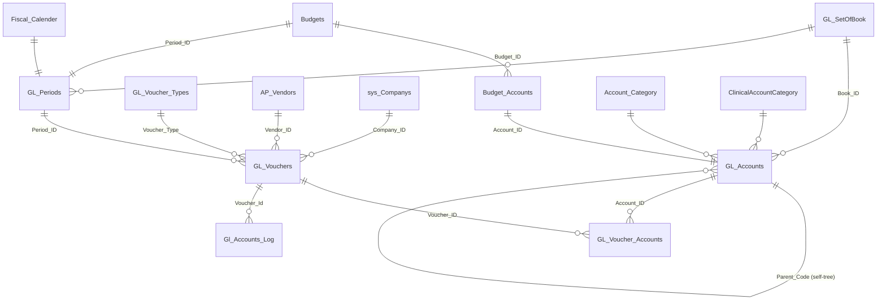

**GL_Vouchers** = single journal entry. Lines = `GL_Voucher_Accounts` (Dr/Cr). One voucher per `Bill` / `Payment` / `Manual_Invoice`.

---

## 10. HR & Rosters

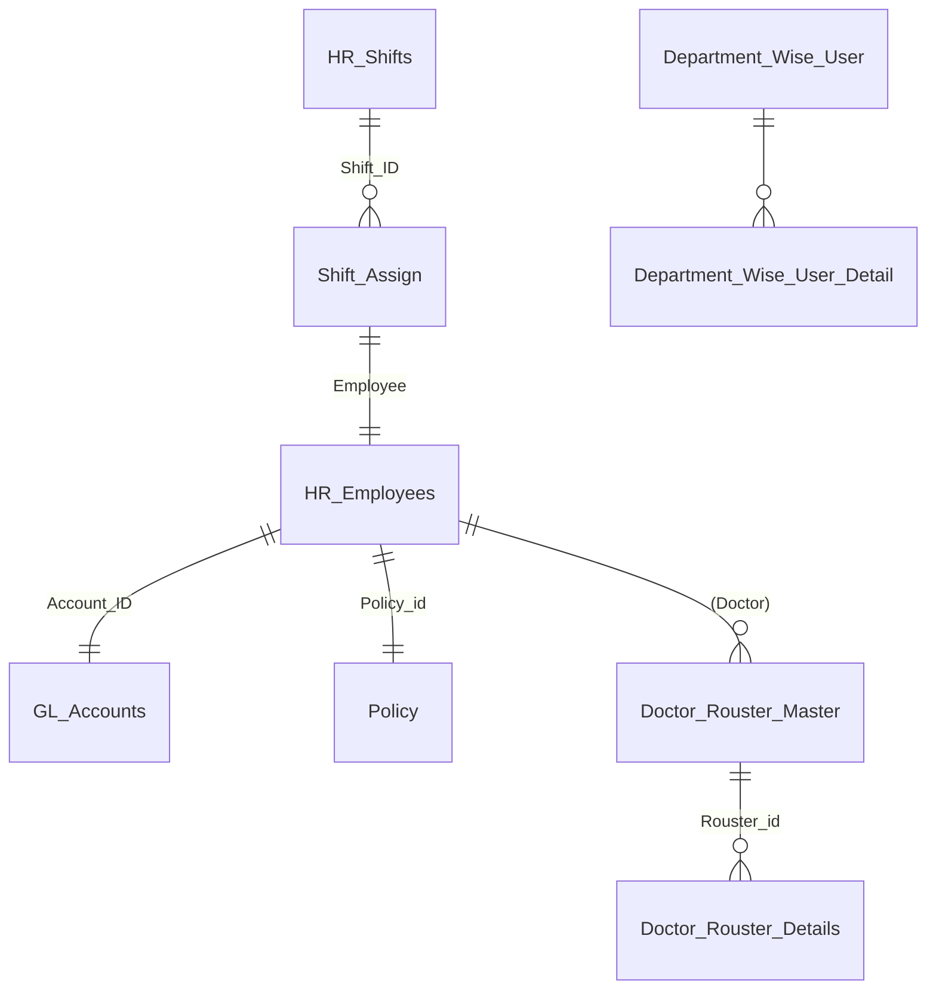

---

## 11. Packages & Panels (catalog)

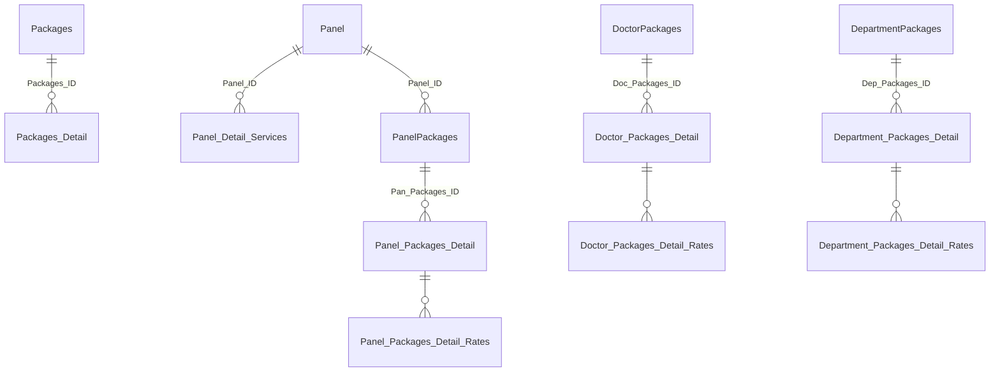

`Doctor_Template_Master` + `Doctor_Template_Medicine` + `Doctor_Template_Test` = doctor shortcut templates (pick medicines/tests for an OPD consult).

---

## 12. Approvals Engine

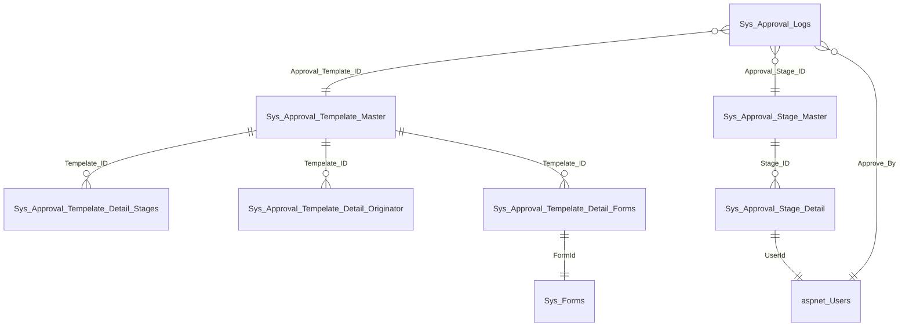

**Universal approver pattern** — `Sys_Approval_Logs.Entry_ID` + `Form_ID` link to any document (PO/PR/PI/Voucher/etc.) via `Approve*.aspx.cs` pages.

---

## 13. Full PK catalog (every table)

> Format: `Table | PK_col`. 314 tables, all PKs listed below for newcomers hunting `WHERE PK = ?`.

| Table | PK |
|---|---|
| Account_Category | Account_Category_Id |
| Accounting_Payment_Purchase_Invoice | Accounting_ID |
| Advance_Payment | Advance_ID |
| Advance_Payment_Purchase_Invoice | Advance_Purchase_Invoice_ID |
| Advance_Tax | Advance_Tax_ID |
| AP_Purchase | Purchase_ID |
| AP_Purchase_Items | Purchase_Item_ID |
| AP_Purchase_Order_Items | PO_Item_ID |
| AP_Purchase_Orders | PO_ID |
| AP_RequestForQuotation_Items | RFQ_Item_ID |
| AP_RequestForQuotation_Vendors | RFQ_VendorDetail_ID |
| AP_RequestForQuotations | RFQ_ID |
| AP_Vendor_Companies | Companies_Detail_Id |
| AP_Vendor_General_Items | GeneralItem_Detail_Id |
| AP_Vendor_Pharmacy_Items | PharmacyItem_Detail_Id |
| AP_Vendors | Vendor_ID |
| AP_Vendors_Person | Person_Id |
| Appointment_Form | Appointment_ID |
| ApprovalHierarchy_Detail | Detail_Id |
| ApprovalHierarchy_Master | ID |
| AR_Advances | Advance_ID |
| AR_Billing_Detail_Doctor_Share | Record_ID |
| Ar_Billing_Details | Bill_Details_ID |
| Ar_Billing_Logs | Log_Id |
| Ar_Billings | Bill_ID |
| Ar_Customers | Customer_ID |
| AR_Invoice | Invoice_ID |
| AR_Invoice_Items | Invoice_Item_ID |
| Ar_PaymentForm | PaymentForm_ID |
| Ar_PaymentForm_Details | PaymentForm_Details_ID |
| AR_Quotation_Items | Quotation_Item_ID |
| AR_Quotations | Quotation_ID |
| Ar_Sales | Sales_ID |
| AR_Sales_Items | ID |
| Asset_Category | Asset_Category_Id |
| Asset_Definition | Asset_Definition_Id |
| Asset_Definition_Cost_Fill | Cost_Fill_Id |
| Asset_Depereciation | Asset_Dep_ID |
| Asset_Depereciation_Detail | Asset_Dep_Detai_Id |
| Asset_Expense | Asset_Expense_ID |
| Asset_Expense_detail | Asset_Expense_Detail_ID |
| Asset_Retirement | Asset_Ret_ID |
| Asset_Retirement_detail | Asset_Ret_Detail_ID |
| Asset_Selection | Asset_Selection_ID |
| Asset_SubCategory | Asset_SubCat_ID |
| Assign_Hostel_Room | Assign_Hostel_Room_ID |
| Bill_BOM_Consumption | ID |
| Birth_Certificate | Birth_Certificate_ID |
| Blood_Bank | Blood_ID |
| Blood_Division | Blood_Division_Id |
| Blood_Division_Type | Blood_Division_Type_Id |
| Blood_Donor | Blood_Donor_ID |
| Blood_Transfusion | BTR_Id |
| Blood_Transfusion_CheckList | CheckList_BTR_Id |
| Branch | branch_ID |
| Branch_Wise_User | Branch_wise_User_Id |
| Branch_Wise_User_Detail | Branch_wise_Detail_Id |
| Budget_Accounts | Budget_account_ID |
| Budgets | Budget_ID |
| Bus_Stop | Stop_ID |
| Child_Birth | Enrollment_ID |
| Client_Information | Entry_ID |
| ClinicalAccountCategory | Id |
| company_opd_policy | id |
| ComplaintsDefinition | ID |
| Configuration | Configuration_ID |
| Consultation_Booking | Consultation_B_ID |
| Consultation_Prescribed_Medicine_Detail | P_Medicine_ID |
| Consultation_Test_Detail | Consultation_Test_Dtl_ID |
| CS_Vendor | CS_Ven_ID |
| CS_Vendor_Master | CS_Ven_Master_ID |
| CTScanLevels | CTScanLevel_ID |
| DataValues | DataValue_ID |
| Department_Packages_Detail | Dep_Detail_Id |
| Department_Packages_Detail_Rates | Dep_Package_Detail_Rate_ID |
| Department_Wise_User | Dept_Wise_User_Id |
| Department_Wise_User_Detail | Dept_Wise_User_Detail_Id |
| DepartmentPackages | Dep_Packages_ID |
| Depereciation_Policy | Depereciation_ID |
| Derma_Appointment | Derma_Appointment_Id |
| DiagnosisDefinition | ID |
| Dialysis_Case | Dialysis_Case_ID |
| Dialysis_DuringDialysis | ID |
| Dialysis_PostDialysis | ID |
| Dialysis_PreDialysis | ID |
| Dialysis_Visit | Dialysis_Visit_ID |
| Dialysis_Visit_Srvc_Dtl | Dialysis_Visit_Srvc_Dtl_ID |
| Discharge | Discharge_ID |
| Discharge_Details | Discharge_Details_ID |
| Discount_Assign_Bill | Discount_Assign_ID |
| Discount_Assign_Detail_bill | Discount_Detail_ID |
| Discount_Assigned_Patient | Discount_Assigned_Patient_Id |
| Discount_Assigned_Patient_Detail | Discount_Assigned_Patient_Detail_id |
| Discount_Definition | Discount_Definition_Id |
| Discount_Definition_Detail | Discount_Definition_Detail_id |
| Doctor_Agreement | Doc_agreemnt_id |
| Doctor_agreement_detail | doc_detail_id |
| Doctor_Packages_Detail | Doctor_Detail_Id |
| Doctor_Packages_Detail_Rates | Doc_Package_Detail_Rate_ID |
| Doctor_Rouster_Details | Rouster_Detail_Id |
| Doctor_Rouster_Master | Rouster_id |
| Doctor_Template_Master | Template_Id |
| Doctor_Template_Medicine | Template_Medicine_id |
| Doctor_Template_Test | Template_Test_id |
| DoctorPackages | Doc_Packages_ID |
| DonationRecords | RecordID |
| Donor | Donor_Id |
| Emergency | Emer_id |
| Emergency_Case | Emergency_Case_ID |
| Emergency_Case_Srvc_Dtl | Emergency_Case_Srvc_Dtl_ID |
| Emergency_Doctor_Note | Emergency_Doc_Id |
| Emergency_Patient | Emergency_ID |
| Emergency_refund | Refund_ID |
| EN_Colono | Colono_ID |
| EN_Gastro | Gastro_ID |
| EyeDetails | ID |
| EyeMainTypes_Definitions | MainTypeID |
| EyeSubTypes_Definitions | SubTypeID |
| Fiscal_Calender | Fiscal_Period_ID |
| Further_Tax | Further_Tax_ID |
| GL_Accounts | Account_ID |
| Gl_Accounts_Log | Log_Id |
| GL_Days_Process | Process_ID |
| GL_SetOfBook | Book_ID |
| GL_Voucher_Accounts | Voucher_account_ID |
| GL_Voucher_Types | Voucher_Type |
| GL_Vouchers | Voucher_ID |
| Goods_Return_Details | SR_Detail_Id |
| Goods_Return_Notes | Store_Return_Id |
| GRN_Detail | GRN_detail_Id |
| GRN_Master | GRN_ID |
| History_Data | History_Id |
| HL7Messages | Id |
| Hostels | Hostel_ID |
| House_Keeping | House_Keeping_ID |
| HR_Employees | Emp_ID |
| HR_Shifts | Shift_ID |
| Igp_Detail | Igp_item_ID |
| Igp_master | Igp_Id |
| In_Patient | In_Patient_ID |
| In_Patient_Medicines | In_Patient_Medicine_ID |
| In_Patient_Srvc_Dtl | In_Patient_Srvc_Dtl_ID |
| Infusion_Order | Infusion_Order_ID |
| InPatient_Doctor_Note | Doctor_Note_ID |
| InPatient_Instruction | Instruction_ID |
| InPatient_Mon_InTake | Intake_ID |
| InPatient_Mon_Output | Output_ID |
| InPatient_Mon_Progress_Note | Output_ID |
| InPatient_Monitoring | InPatient_Mon_ID |
| InPatient_Monitoring_Detail | InPatient_Mon_Dtl_ID |
| InPatientServices | ServicesId |
| inv_bom | BOMID |
| inv_bom_detail | BOMDetailID |
| INV_Item_Account_Category | Category_ID |
| INV_Item_Account_Category_Details | INV_Item_Account_Category_Detail_ID |
| INV_ITEM_COMPANIES | ITEM_COMP_ID |
| INV_ITEM_COMPANY_STORES | ITEM_STORE_ID |
| inv_item_costing_logs | id |
| INV_Item_PatientWise | Item_Rate_Id |
| INV_Item_RateBatchWise | Item_Rate_Id |
| INV_Items | Item_ID |
| INV_Stock_Adjustment | Adjustment_ID |
| IPD_Distribution_Detail | Distribution_Detail_Id |
| IPD_Distribution_Master | Distribution_Id |
| IPD_Doctor_Distribution_Detail | Doctor_Distribution_Id |
| Issue_To_Laundary | Issue_To_Laundary_ID |
| Item_Org | Org_ID |
| Item_Replacement_Detail | Item_Replacement_Detail_Id |
| Item_Replacement_Master | Item_Replacement_Id |
| Item_Warehouse_Mapping | Id |
| ItemSelection_Barcode | Barcode_ID |
| ItemSelection_Detail | Selection_Detail_Id |
| ItemSelection_Master | Selection_ID |
| Lab_Resultrpt | Lab_Result_ID |
| Lab_Test_Detail | Lab_Test_Detail_ID |
| Lab_Test_Multiple_Value | Lab_Test_Multiple_Value_ID |
| Lab_Tests | Test_ID |
| Laboratory_Test | Lab_Test_ID |
| Laundary_Issuance | Laundary_Issuance_ID |
| Laundary_Received | Laundary_Received_ID |
| Location | Location_ID |
| Manual_Invoice | ManualInvoiceId |
| Manual_Invoice_Detail | ManualInvoiceDetailId |
| MaterialIssueRequest | MaterialRequest_Id |
| MaterialIssueRequest_Detail | MaterialRequestDetail_Id |
| Medicines_Template | template_id |
| Medicine | (see schema) |
| Menus | Menu_ID |
| MRILevels | MRILevel_ID |
| Next_To_Kin | Guardian_Id |
| OPD_Refund | Refund_ID |
| Operation_Booking | Operation_Booking_ID |
| Operation_Booking_Srvc_Dtl | Operation_B_Srvc_Dtl_ID |
| Ortho | Ortho_ID |
| Out_Patient | Out_Patient_ID |
| Out_Patient_Eye_Info | Out_Patient_Eye_Info_ID |
| Out_Patient_Slit_Lamp_Exam | Out_Patient_Slit_Lamp_Exam_ID |
| OutPatientComplaints | ID |
| OutPatientFinalDiagnosis | ID |
| OutPatientPrimaryDiagnosis | ID |
| OutPatients_Protos | Proto_id |
| Packages | Packages_ID |
| Packages_Detail | Package_Detail_ID |
| Panel | Panel_ID |
| Panel_Detail_Services | Panel_Detail_Services_ID |
| Panel_Packages_Detail | Panel_Detail_Id |
| Panel_Packages_Detail_Rates | Pan_Package_Detail_Rate_ID |
| PanelPackages | Pan_Packages_ID |
| Patient_Appointment | Appointment_ID |
| Patient_Billing_Dtl | Patient_Bill_Dtl_ID |
| Patients | Patient_ID |
| Payment_Invoice | PaymentInvoiceId |
| Payment_Invoice_Detail | PaymentInvoiceDetailId |
| Pharmacy_SaleReturn_Details | ID |
| Pharmacy_SaleReturns | Return_ID |
| Pharmacy_Template_Detail | ID |
| Pharmacy_Template_Master | ID |
| Pharmacy_Users | UserID |
| Physiotherapy_Assessment | Physio_ID |
| Physiotherapy_ROM | ROM_ID |
| Physiotherapy_Treatment_Plan | Treatment_ID |
| Policy | Policy_ID |
| Policy_Department_Assignment | Policy_Assign_Dep_id |
| Policy_Details | Policy_Detail_ID |
| Previous_Dpt | Perivious_Dpt_ID |
| ProcedureLevels | ProcedureLevel_ID |
| PT_Endoscopy | Endoscopy_ID |
| Purchase_Invoice_Detail | PurchaseInvoiceDetailId |
| Purchase_Invoice_Master | PurchaseInvoiceId |
| Purchase_Requisition | PR_Id |
| Purchase_Requisition_Detail | PR_Detail_ID |
| Purchase_Return_Detail | Purchase_Return_Detail_ID |
| Purchase_Return_Master | Purchase_Return_ID |
| Receipts | Receipt_ID |
| Received_From_Laundry | Received_From_Laundry_ID |
| ReceivingNotes | ReceivingNoteID |
| Refund | Refund_ID |
| Refund_Detail_Doctor_Share | ID |
| Refund_Detail_Services | ID |
| Reg_patient | **pat_id** ← master patient ID |
| Reg_Patient_Logs | Log_Id |
| Result_Organism | Organism_ID |
| Role_Page | Role_Page_Id |
| Room_Allocation | Room_Allocation_ID |
| Room_Allocatrion_History | Room_Allocatrion_History_ID |
| Rooms | Room_ID |
| Route_Driver | RD_ID |
| Routes | Route_ID |
| rpt_Aging | (per rpt schema) |
| rpt_BalanceSheet | ID |
| rpt_DailyBook | Line_Id |
| rptSelectionParameters | (per rpt schema) |
| rptSetParameter | (per rpt schema) |
| Sales_Tax | Sales_Tax_ID |
| Sample_Detail | Sample_Detail_ID |
| Sample_Master | Sample_ID |
| Segment_Detail | SegmentId |
| Service_Definition | Service_Definition_ID |
| Shift_Assign | Shift_Assign_ID |
| Stock_Transfer | Stock_Transfer_ID |
| Stock_Transfer_Items | Stock_Transfer_Items_ID |
| Store_Issue | Store_Issue_Id |
| Store_Issue_Detail | Store_Issue_Detail_Id |
| Surve_Form | Survey_Id |
| SymptomsCategorization | Id |
| Sys_Approval_Logs | ID |
| Sys_Approval_Stage_Detail | Stage_Detail_Id |
| Sys_Approval_Stage_Master | Stage_ID |
| Sys_Approval_Tempelate_Detail_Forms | Id |
| Sys_Approval_Tempelate_Detail_Originator | Id |
| Sys_Approval_Tempelate_Detail_Stages | Id |
| Sys_Approval_Tempelate_Master | Tempelate_ID |
| sys_Companys | Company_ID |
| Sys_Forms | Form_ID |
| Sys_Inv_OrignatorTempelate_Detail | Id |
| Sys_Inv_OrignatorTempelate_Detail_Forms | Id |
| Sys_Inv_OrignatorTempelate_Master | OrignatorTempelate_ID |
| Sys_MsgLogs | LogId |
| sys_Parms | ID |
| Sysmtopms | ID |
| Terms_and_conditions | Term_ID |
| Test_Defination_Detail_Rates | Test_Defination_Detail_Rates_ID |
| Test_Image | Image_ID |
| Test_Values | (per lab schema) |
| TimeShedule | Schedule_ID |
| Token | Token_ID |
| UltraSoundLevel | UltraSoundLevel_ID |
| User_Branch | User_Branch_Id |
| User_Branch_Master | User_Branch_Master_Id |
| user_tills | id |
| User_Wise_Template | User_Wise_Template_Id |
| User_Wise_Template_Detail | User_Wise_Template_Detail_Id |
| UserDataTablePreferences | PreferenceID |
| ValueSet | ValueSet_ID |
| Vehicle_Route | VR_ID |
| Vehicles | VID |
| Ward_Allocation | Ward_Allocation_ID |
| Ward_Allocatrion_History | Ward_Allocatrion_History_ID |
| Ward_Definition | Ward_ID |
| Warehouse_Item_Batches | ID |
| WareHouse_Wise_User | WareHouse_wise_User_Id |
| WareHouse_Wise_User_Detail | WareHouse_wise_Detail_Id |
| WithHold_Tax | WithHold_Tax_ID |
| XRayLevels | XRayLevel_ID |

---

## 14. Caveats for newcomers

1. **25 DB FKs, 317 tables.** Don't trust SQL JOINs to fail on missing parent — they won't. Check in code.
2. **Same column = different meanings.** `Patient_ID` exists in `Reg_patient` (no), `Patients`, and 30+ child tables — always confirm context.
3. **Naming is wild.** `In_Patient_Medicines` is plural; `In_Patient` is singular; `Ar_Billings` and `Ar_Billing_Details` differ by one `s`. PKs mostly `_ID`/`_Id`.
4. **Multi-FK on one table.** `Ar_Billings` holds `Patient_ID` + `Opd_Id` + `In_Patient_ID` + `Appointment_id`. Pick the right encounter FK by context.
5. **IsPharmacy / BillType flags.** Most encounter-agnostic tables use `IsX` columns to indicate encounter type instead of separate tables.
6. **Tenant leakage risk.** Every write must include `Company_ID` and `Book_ID` from `AppConfig.*`. Code does this — but ad-hoc SQL will silently cross tenants.
7. **Approvals** = universal trail via `Sys_Approval_Logs.Form_ID` constant per form. See `Approve*.aspx.cs` for mappings.
8. **Reg_Patient_Logs** = JSON snapshot of `Reg_patient.PatData` written before any update. Audit-only.
9. **Two parallel donor tables** (`Donor` vs `Donors`). `Blood_Division.Donor_Id` points to legacy `Donors`.
10. **LINQ-to-SQL** = source of truth. Any schema question: grep `DataBase.designer.cs` AND check `.aspx.cs` Save handler.

---

## 15. How to read any module quickly

1. Find the **master** (usually `*_Master` or table with `_*_No` code column).
2. Run `grep -r "<MasterName>" Modules/<X>/` to find pages.
3. Open `Save`/`InsertOnSubmit` block → list every column assigned.
4. Each `<column> = <value>` is a logical FK. Trace value back to source table.
5. Master-detail = two tables; usually PK ends `_ID` + child ends `_Detail_ID`.

**Time to productivity:** 1 day if you accept "no FKs", 1 week if you fight it.
